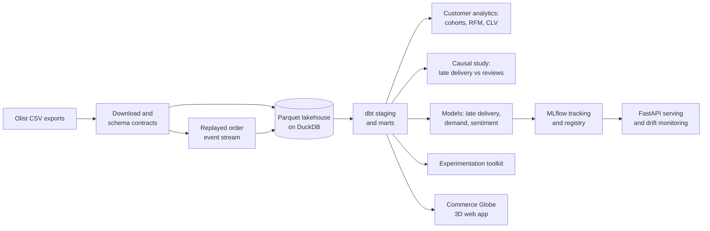

# ecommerce-data-ai-platform

[](https://github.com/mohammadazam7/ecommerce-data-ai-platform/actions/workflows/ci.yml)

An end-to-end commerce data and machine learning platform on real marketplace data:
from raw order exports to tested data marts, customer analytics, production-style
models and controlled experiments.

> **Status:** in development. The project foundation is in place; see the
> [roadmap](docs/ROADMAP.md) for milestone dates. Results will be published here only
> once they have been measured.

## Overview

An online marketplace generates orders, payments, deliveries and reviews across
thousands of sellers. The questions that matter are cross-cutting: which customers are
worth retaining, how much a late delivery really costs in satisfaction, which orders are
likely to arrive late, how demand will move next month, and whether a change to the
checkout or delivery promise actually helped.

This project answers them on the public [Olist](https://github.com/olist/work-at-olist-data)
Brazilian marketplace data set: about 100,000 orders placed from 2016 to 2018, with
customers, sellers, products, payments, delivery dates and written reviews in
Portuguese. The data is real and anonymised, which keeps every result checkable.

## Architecture



| Layer | Responsibility |
|---|---|
| Ingestion | Download the exports, validate them against schema contracts, write a Parquet lakehouse, and replay orders as an event stream for incremental processing |
| Modelling | dbt marts for orders, customers, sellers, products, reviews and deliveries, with tests and contracts, orchestrated with data quality checks |
| Analytics | Cohort retention, RFM segmentation, customer lifetime value, and the effect of late deliveries on review scores |
| Machine learning | Late-delivery prediction, demand forecasting by category and review sentiment, each against a simple baseline, with model cards |
| Operations | Experiment tracking and a model registry, batch scoring, an HTTP service and drift monitoring |
| Experimentation | Power analysis, variance reduction (CUPED) and sequential testing on simulated experiments built from real baselines |

## Getting started

```bash
python -m venv .venv && source .venv/bin/activate
make install
make check

commerce download                 # nine Olist files, pinned and checksummed
commerce bronze                   # validate every table and write the bronze layer
commerce replay --batches 30      # replay the next 30 days of order events
```

`commerce bronze` refuses to write anything if a table breaks its contract. `commerce
replay` keeps a watermark in `data/lake/stream/order_events/`; run it again to continue,
or pass `--start` to rerun from an earlier time without duplicating events. See
[docs/DATA.md](docs/DATA.md) for the source, licence and table quirks.

## Data and licence

Code is released under the MIT licence. The Olist data set is published by Olist under
the MIT licence; it is downloaded by a script and not redistributed in this repository.
